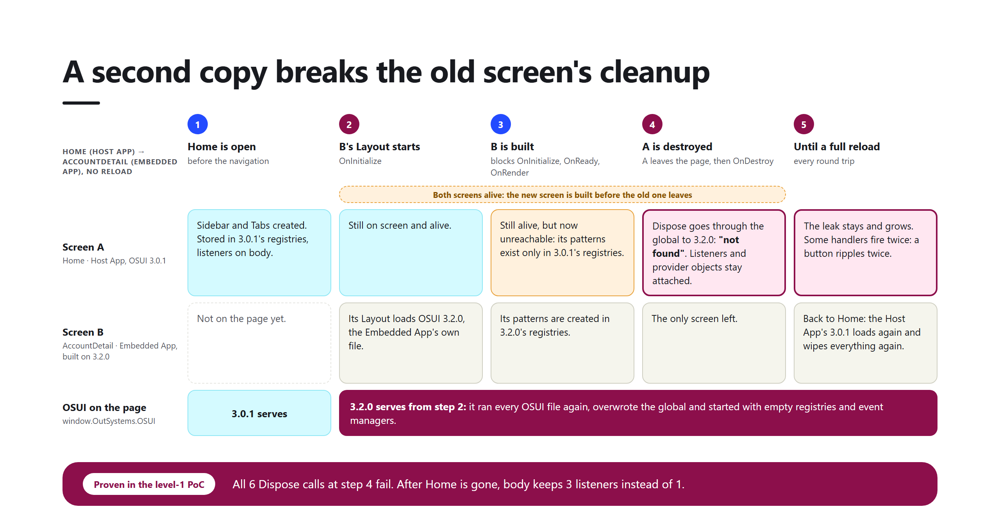
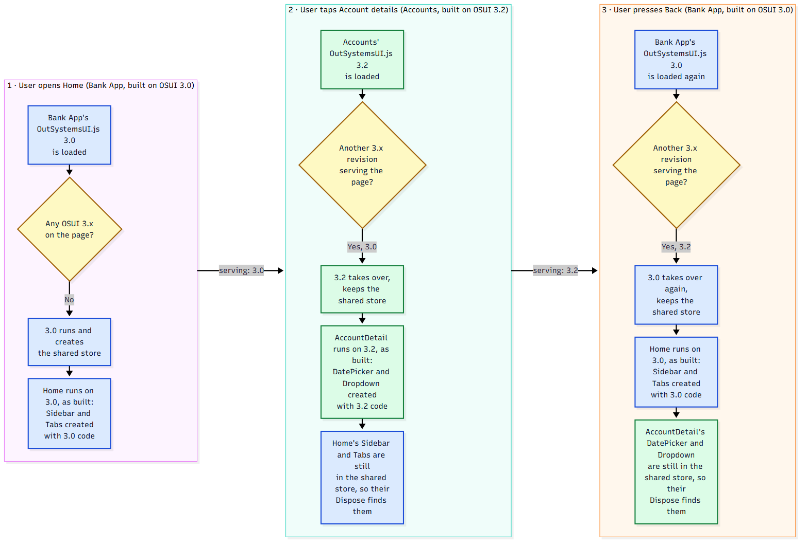

# ROU-13176 — Modular Apps (micro frontends): impact on OutSystems UI

Detailed design input for the spike ROU-13176
("[OSUI] Micro Frontends - High Level Design"), epic
RPOR-30810. It covers what has to change in OutSystems
UI (OSUI), what the concerns are, what is and is not the UI Components team's responsibility, the best possible
solution, the most balanced solution, and a ballpark estimate.

- **Status:** draft for team review. Every conclusion was challenged by an independent reviewer pass. A second
  independent review on 2026-11-19 checked this document, the HLD and the 7 Nov review against each other and
  against the code. The verdicts that changed the text are listed in
  [Corrections to earlier notes](#12-corrections-to-earlier-notes).
- **Date:** 2026-11-13. **Updated 2026-11-19** after the HLD author's answers: each app loads its own OSUI. See
  [§13](#13-update-after-the-hld-authors-answers-2026-11-19). **Updated 2026-11-20** with the author's follow-up
  answers (§13.5): no option changes, Q15 is new, and the open questions go to a meeting with client-runtime.
- **Code baseline:** `outsystems-ui` `dev` at `2e4077c00`, package `3.0.0`, compiled `dist/ODC.OutSystemsUI.js`
  and `dist/ODC.OutSystemsUI.css`.
- **The only written record of the analysis.** It replaces three earlier notes, which were removed on 2026-11-19:
  the working notes (5 Nov, written before the HLD was read), the 7 Nov design review ("Option A"), and a note
  quoting the HLD on the Developer Guidelines (13 Nov). Where this document says "working notes" or "7 Nov
  review", it refers to those notes. What they concluded and what changed is in
  [Corrections to earlier notes](#12-corrections-to-earlier-notes).
- **What this document takes from the 7 Nov review.** The review was written against an earlier `dev` baseline
  and proposed three options for letting several revisions of a library coexist on one page. None of them is
  this document's recommendation: S1 (§7.1) is this document's own design.
    - **Option A, a library-side versioned registry** (the review's recommendation). Every bundle registers under
      its exact version in `window.__osLibs`, the public global is a facade, and each app's module JS binds to its
      own copy. Here it is **S2**, and it is not recommended (§7.2).
    - **Option B, runtime-scoped evaluation.** The client runtime evaluates each app's script inside its own
      function scope. **It is not carried forward and not analysed here.** The review itself kept it only as a
      fallback: it fails under a CSP without `unsafe-eval`, it breaks customer scripts that read the globals, and
      it doubles the parse cost.
    - **Option C, an ES-module rebuild with federation sharing** (the review's long-term direction). Here it is
      **S3** (§7.3).

  Also taken from the review: the `__osLibs` registry key, the extensibility-workaround analysis
  behind C8 (§5) and the library-specific work for Charts, Maps and Data Grid (§8). Where this document disagrees
  with the review, the row is in [Corrections to earlier notes](#12-corrections-to-earlier-notes). The review's
  text is not reproduced or linked in this repository.

---

## 1. Summary

**What the platform asks of us.** In the HLD, the UI Components team owns one work item: make OutSystems UI,
Charts, Maps and the other UI Components libraries _follow the Developer Guidelines_. The HLD spells out four
rules: "a second load is a no-op that never resets state, globals are kept per major version, CSS is prefixed,
and listeners are attached per pattern instead of at load time". OSUI is the reference implementation. The
client runtime does not protect a library that does not comply: each navigation to an Embedded App loads that
app's libraries, OSUI included (§3.4, §13).

**The guidelines are not written yet, so this investigation works from the HLD's four rules.** The HLD refers to
a Developer Guidelines document ("draft below"), but we found no draft on the page (§3, item 8) and no owner
for it (Q4). As a working assumption, this analysis takes the four HLD rules above as the reference for OSUI
until that document is published; they may change when it is. Where this
investigation departs from the HLD wording (the CSS prefix, "per major"), the point is put to the HLD authors
as a question (Q3, Q14).

**What that means for OSUI, rule by rule:**

| HLD rule                                         | OSUI today                                                                                                                                                                                                                                                                            | What to do                                                                                                                                                                             |
| ------------------------------------------------ | ------------------------------------------------------------------------------------------------------------------------------------------------------------------------------------------------------------------------------------------------------------------------------------- | -------------------------------------------------------------------------------------------------------------------------------------------------------------------------------------- |
| A second load is a no-op that never resets state | **Fails.** A second load re-runs every namespace and re-creates 33 pattern registries, 2 event-manager singletons and about ten other module-level variables and handlers empty. The first copy's live instances become unreachable                                                   | Fix: a version guard plus shared state (§7.1)                                                                                                                                            |
| Globals per major version                        | **Fails** today, and the rule is **under-specified**. Two 3.x revisions still share one key. Taken literally, "per major" does not stop the second from overwriting the first                                                                                                         | Fix: one live copy per major, with an explicit "last loaded revision wins" policy (§7.1)                                                                                               |
| CSS is prefixed                                  | **Not applicable to OSUI.** About 86 % of the class-led selectors are unprefixed public vocabulary (`.btn`, `.card`, layout, utilities) that customers write in their own markup. Prefixing them is a breaking rename of the whole public CSS surface                                 | **TBD.** This first assessment did not look into CSS in depth, so no rule is proposed here yet. Open points: Q13, Q14                                                                  |
| Listeners per pattern, not at load time          | **Mostly true, with one exception.** `PreviewInDevices/OnPostMessage.ts:133` registers a window `message` handler at load when the page is framed (ODC only). Some module-level handlers (Menu, deprecated submenu) are registered by layout actions rather than by pattern instances | Move the `OnPostMessage` registration behind an initializer, and make module-level handlers survive a switch (§7.1)                                                                    |

**The problem to solve.** When a user navigates between a Host App and an Embedded App built on different OSUI
revisions, the second app's OSUI script runs on the same page. Today it re-creates every registry and global
manager empty and re-assigns the API functions. The target screen is fully built before the old screen's
OnDestroy runs, so the old screen's `Dispose` calls reach the new, empty registries: they fail with "not found",
`dispose()` never runs, and listeners and instances leak. It happens in both directions, on every navigation
between apps on different OSUI files, and grows with each round trip (C2; PoC rows 1, 2 and 2b).



The diagram follows one navigation step by step: screen B and its OSUI copy are built (steps 2–3) before screen A
is destroyed (step 4), so A's `Dispose` calls go through globals that already point to B's copy. S1 (§7.1) is
the solution analysed for it.

**Solutions considered.** This investigation is not finished and does not close on a solution: there is still
room to work on it. Several solutions were considered and are described along the document: one live copy per
major with shared state (S1, §7.1), exact-revision isolation (S2, §7.2) and ES
modules with Native Federation (S3, §7.3). §7 describes each one, §9 gives a ballpark estimate, and §11 lists the
open questions that can still change the picture.

---

## 2. Scope and sources

| Source                                                                                                                                                                                                                                                                                                                                                                           | ID                                       | Used for                                                       |
| -------------------------------------------------------------------------------------------------------------------------------------------------------------------------------------------------------------------------------------------------------------------------------------------------------------------------------------------------------------------------------- | ---------------------------------------- | -------------------------------------------------------------- |
| VM1 HLD, "Web: Compose and Navigate Between Independent Apps (EAP)"                                                                                                                                                                                                                                                                                                              | Confluence `6797787218`, v44, RDSD-11489 | Requirements R01–R26, Client Runtime, UI Components, Assets    |
| [LLD] Micro Frontends in Client-Side                                                                                                                                                                                                                                                                                                                                             | Confluence `6862241988`, v31, RAR-4332   | Layouts, styles, start-up behaviour                            |
| The lifecycle of a Modular App                                                                                                                                                                                                                                                                                                                                                   | Confluence `6994427955`, v9              | Worked example with OutSystemsUI 2.30 and 2.31                 |
| RAR-4236 Modular Apps native-federation PoC                                                                                                                                                                                                                                                                                                                                      | Confluence `6640238769`, v3              | Global-namespace collision risk                                |
| Client Runtime Versioning                                                                                                                                                                                                                                                                                                                                                        | RAR-4311                                 | Compatibility within a major (HLD A02)                         |
| Governance for Public Elements                                                                                                                                                                                                                                                                                                                                                   | RPOR-9436                                | Sharing rules (HLD A01)                                        |
| OSUI source and compiled bundle                                                                                                                                                                                                                                                                                                                                                  | this repository                          | Every code claim (file:line)                                   |
| [Native Federation core](https://github.com/native-federation/native-federation-core), [Angular Architects on version mismatches](https://www.angulararchitects.io/en/aktuelles/getting-out-of-version-mismatch-hell-with-module-federation/)                                                                                                                                    | public                                   | `singleton`, `strictVersion`, what federation does not isolate |
| Provider docs: [Splide](https://splidejs.com/guides/getting-started/), [Flatpickr](https://flatpickr.js.org/getting-started/) ([issue #1806](https://github.com/flatpickr/flatpickr/issues/1806)), [noUiSlider](https://refreshless.com/nouislider/), [Virtual Select](https://sa-si-dev.github.io/virtual-select/), [Floating UI](https://floating-ui.com/docs/getting-started) | public                                   | Each exposes a `window` global when loaded as a script         |

No public OutSystems documentation describes Modular Apps, Host Apps or Embedded Apps yet. The closest pages
([App architecture](https://success.outsystems.com/documentation/outsystems_developer_cloud/building_apps/app_architecture/))
cover weak dependencies and libraries only.

**Out of scope:** Mobile UI. The HLD states "MobileUI is out of scope: it serves only the ODC Mobile App type,
and this milestone is web-only".

---

## 3. What the platform does (facts that drive the design)

1. **One document, sequential screens.** Composition is not side-by-side. "Each screen renders its own
   Layout, as today: every navigation replaces the whole screen, Layout included, even between screens of the
   same app" (HLD, Client Runtime → Owning the page). "The Host App's chrome doesn't persist across a
   navigation" (LLD, Layouts). At any moment the page shows one screen, owned by one app.
2. **Library logic is per app, library scripts are shared.** "Low-code logic (blocks, client actions,
   structures): compiled into each app's own chunks". "Required scripts (OutSystemsUI's script with its
   providers, Charts, customer scripts): … **Yes** [shared]: `window` globals, called by chunk code" (HLD,
   UI Components). The OSUI module's JavaScript nodes are compiled into each app, but they all call the one
   `window.OutSystems.OSUI`.
3. **An Embedded App's start-up never runs when composed.** "Nothing from an Embedded App's app-level startup
   runs when it's composed: not its app definition, OnApplicationReady, required scripts or error handler
   registration" (LLD, Startup). Its OSUI script reaches the page **at the latest** through its own Layout's
   `RequireOSUI` → `RequireScript` call, when its first screen mounts, and **possibly earlier**: the HLD's
   lifecycle table lists "User scripts by logical name and hash" in the pre-mount work, and the author says the
   Embedded App's libraries load on navigation (§13). **Inference:** the bundle may run while the old screen is
   still fully live, which widens the cross-copy window beyond the render overlap (Q8).
4. **Script loading rule.** Each app loads its own libraries, OSUI included. The Host App's libraries load with
   it; navigating to an Embedded App "unloads" them and loads the Embedded App's (HLD author, §13). This still
   has to be confirmed with the client-runtime team, including what "unload" means for a script that already
   ran (Q11). A script with
   the same URL is not loaded again; with a different URL it is, so two versions of the same script can be on
   the page. The HLD also plans to recognise scripts by logical name and content hash, so that an identical file
   loads once and a different file loads too and is reported; whether that still ships is Q12. There is no
   special treatment for UI Components libraries: a library that cannot survive a second load breaks on the
   first navigation between two apps on different files of it.
5. **CSS: the sources disagree.** The HLD says "the Host App's theme stays on the page. An Embedded App's
   screen and block stylesheets are added on mount and removed on unmount; its own theme is not loaded"
   (CSS under composition; R09). The LLD says "each screen's CSS and JS dependencies resolve under its owning
   app … moving from a Host App screen to an Embedded App screen works like moving between two themes in one
   app today". **This document follows the HLD**, which is the higher-level, team-facing contract, and lists the
   conflict as open question Q1. The same HLD paragraph ends: "Today's per-navigation swap, which removes every
   other stylesheet, must not apply across apps." So today's runtime already swaps stylesheets on every
   navigation, and the HLD plans to stop that between apps. The author's "styles are loaded again on each screen"
   (§13.1) matches today's behaviour, not the HLD's plan. Which one ships is Q13.
6. **Version rules.** The client runtime must be in the same major, and an Embedded App's is never newer than
   the Host App's (R24; "keeping the Host App's client runtime ahead remains a developer responsibility" is R15). Library revisions "may differ", "are reported at promotion and in telemetry", and are
   "never blocked" (R15, R19, R09).
7. **Native Federation does not isolate globals or CSS.** It negotiates ES-module dependencies through import
   maps (`singleton`, `strictVersion`, version ranges). Classic scripts that write to `window` sit outside it.
   This matches the HLD: "import-map scoping isolates neither shared layer" and the PoC's "global-namespace
   collisions … particularly relevant for OutSystemsUI" (RAR-4236).
8. **The HLD contradicts itself in places** (independent review, 2026-11-19). To raise with the HLD author:
    - The runtime topology diagram has the Host App owning "document, router, history, **shell chrome**", while
      R08 and "Owning the page" say every navigation replaces the whole screen, Layout included. This may be where
      the 7 Nov review's "persistent Host shell" reading came from.
    - The Developer Guidelines asset row says "(draft below)", and the Threat Analysis cites "Developer
      Guidelines, For app teams". Neither section exists on the page.
    - The UI Components table calls CSS shared "page-wide", while "CSS under composition" adds and removes each
      member's stylesheets per mount.
    - "Globals are kept per major version" is never defined (C3).
    - R09 says every app "is built on the Host App's base theme", yet a different design-system revision is only
      reported. That sentence supports this document's CSS reading (§3.5).

---

## 4. How OSUI reaches the page (verified in code)

- **Build:** `tsc --outFile` over ambient namespaces (`gulp/Tasks/TsTranspile.js`). No `define()`, no prologue
  or epilogue. `dist/ODC.OutSystemsUI.js` contains 288 top-level `var` blocks that merge into exactly three
  globals: `OSFramework` (170), `OutSystems` (63), `Providers` (55). `dist/O11.OutSystemsUI.js` has a **fourth**:
  `var osui;`, the deprecated namespace from `src/scripts/osui.ts`, which `gulp/ProjectSpecs/DefaultSpecs.js:16`
  excludes from ODC only. Old customer JavaScript on O11 still calls it.
- **Re-execution:** each block is `(function (X) { … })(X || (X = {}))`. A second copy reuses the namespace
  objects and **re-assigns every exported member**. Module-level state inside those functions is created anew.
- **Module-level state that a second load would reset:**
    - 33 pattern registries: `const _<pattern>Map = new Map()` in `src/scripts/OutSystems/OSUI/Patterns/*API.ts`.
    - `GlobalListenerManager._listenerManager = new ListenerManager()`
      (`OSFramework/OSUI/Event/DOMEvents/Listeners/ListenerManager.ts:33`).
    - `ObserverManager._observerManager` (`Event/DOMEvents/Observers/ObserverManager.ts:23`).
    - `Utils/Menu.ts`: `_appProp` (`:9`), `_onOrientationChangeCallback` (`:4`), `_onResizeTimeout` (`:6`).
    - `Utils/IconLibrary.ts:9` `_iconLibrary` (ODC only).
    - `Behaviors/Scroll.ts:3` `_controllScroll`.
    - `Utils/LayoutPrivateCloseDeprecatedSubmenu.ts:6-8` statics, including `_closeMenuEvent`, a listener on
      `document.body` (O11 only: excluded from ODC, `DefaultSpecs.js:17`, so not part of the Modular Apps work).
    - `Utils/PreviewInDevices/OnPostMessage.ts:10` `_isInPreviewInDevices` (ODC only).
    - `Helper/Dates.ts:5` `_serverFormat`.
    - `Utils/ButtonsEffect.ts:67`: not a variable, but a statement that runs at load. It adds `_bodyClick` to
      the `BodyOnClick` listener of the global manager (found by the level-1 PoC, §7.1).
    - `Device.*` static caches (`Helper/Device.ts:114-122`) are recomputed and harmless.
    - The bundle defines no `window.<name> =` globals at load. One dynamic write exists:
      `AbstractListener.ts:49` writes `window[this._eventName]` for custom events, when a listener is created.
- **Listeners:** pattern listeners attach lazily. The manager constructs a listener only on the first
  `addHandler` (`Event/DOMEvents/AbstractEventsManager.ts:22-32`), and `AbstractListener` attaches in
  `addEvent()`, which its constructor schedules (`Listeners/AbstractListener.ts:52-63`). **Two exceptions**
  register at namespace level, when the bundle runs:
    - `OnPostMessage.Set()` (`PreviewInDevices/OnPostMessage.ts:133`) registers a window `message` handler
      whenever the page is framed (`window.self !== window.top`, `:113`). The file is excluded from O11
      (`gulp/ProjectSpecs/DefaultSpecs.js:12`).
    - `ButtonsEffect` (`Utils/ButtonsEffect.ts:67`) adds `_bodyClick` to the `BodyOnClick` listener on every
      page, both targets. A second copy adds it again, so every `.btn` click renders the ripple twice, today and
      under S1 as first written (PoC test F1, §7.1).
      A sweep for other statements that run at namespace level (not only `const _x =` state) found no others
      (independent review, 2026-11-19).
- **Listeners outside the managers:** `Utils/LayoutPrivateBodyCssVars.ts:5-24, 27-40` adds
  `matchMedia(...).addEventListener('change', …)` for dark mode and high contrast on every call, and never
  removes them. Not at load, but each app's Layout calls it on every navigation, so they accumulate.
- **Handler identity:** several registered handlers are module-level functions, not instance closures:
  `Menu._onResizeCallbackHandler`, `_onOrientationChangeCallbackHandler`, `_menuOnKeypress`,
  `OnPostMessage._message`, `CloseDeprecatedSubmenu._closeMenuEvent` (O11 only) and `ButtonsEffect._bodyClick`. `removeHandler` and
  `removeEventListener` remove by reference (`AbstractEventsManager.ts:71-80`), so a copy can only remove the
  handlers it registered itself.
- **Cross-copy identity:** one `instanceof` between framework classes,
  `UpdatePositionOnScroll.ts:27` (`OSUIFlatpickrTime`).
- **Lookups:** `FindInMap` matches by `uniqueId`, then falls back to the **last** pattern whose `widgetId`
  matches (`Helper/MapOperation.ts:18-31`).
- **Version:** `Constants.OSUIVersion = '3.0.0'` (`Constants.ts:189`), exposed by `GetVersion()`. Nothing else
  reads it.
- **CSS:** `dist/ODC.OutSystemsUI.css` has 5,236 selectors whose first compound is a class: 710 start with
  `.osui-` and 4,526 do not, so about **86 %** are unprefixed. 271 of those 4,526 reach an `.osui-` class
  through a context class (`.is-rtl .osui-…`), so the purely public vocabulary is about 81 %. (An earlier count
  gave 5,609 selectors and 1,092 KB; the review could not reproduce them on the current `dist`, 1,142,821 bytes.) There are 52 `html`-led and 49 `body`-led selectors,
  and 2 `:root` blocks. The unprefixed vocabulary is intentional: "`src/scss/` classes: no prefix — `.card`,
  `.btn`, `.alert`" (`.claude/rules/scss.md` §5).

---

## 5. Concerns

Severity is for customers composing Modular Apps. "When" says which pages the concern reaches.

| #   | Concern                                                                                                                                                                                                                                                                                                                                                                                                                                                                                                                                                                                                                                                                                                                                                             | When                                                  | Severity                                  | Evidence                                                                                               |
| --- | ------------------------------------------------------------------------------------------------------------------------------------------------------------------------------------------------------------------------------------------------------------------------------------------------------------------------------------------------------------------------------------------------------------------------------------------------------------------------------------------------------------------------------------------------------------------------------------------------------------------------------------------------------------------------------------------------------------------------------------------------------------------- | ----------------------------------------------------- | ----------------------------------------- | ------------------------------------------------------------------------------------------------------ |
| C2  | **Second load wipes state.** When a second, different OSUI file runs, it re-creates every registry and both singletons empty. The first copy's instances can no longer be disposed or changed: lookups throw "not found", listeners and provider objects leak. This happens on every navigation between apps on different OSUI files, and it also happens under S1 whenever one of the two revisions predates S1 (§7.1, precondition)                                                                                                                                                                                                                                                                                                                               | Every navigation between apps on different OSUI files | Critical                                  | §4; PoC rows 1, 2, 2b                                                                                  |
| C3  | **"Per major" is under-specified.** 3.0.1 and 3.2.0 share a major. Unless the rule says what happens between two revisions of one major, it re-creates C2                                                                                                                                                                                                                                                                                                                                                                                                                                                                                                                                                                                                           | Two revisions of one major on the page                | High (HLD wording)                        | HLD UI Components; R19 expects same-major differences to be common                                     |
| C4  | **CSS is one revision, the Host App's.** Markup from an Embedded App on another revision meets the Host App's CSS. A new class or DOM change from a newer minor renders unstyled. Across majors (2.x classic theme and 3.x token theme) it breaks visually. Runtime code cannot fix this                                                                                                                                                                                                                                                                                                                                                                                                                                                                            | Every composed page                                   | High across majors, Medium within a major | §3.5; R09                                                                                              |
| C5  | **"Prefix CSS" cannot be delivered for OSUI** without renaming its public class vocabulary. That is a breaking change for every customer stylesheet and markup                                                                                                                                                                                                                                                                                                                                                                                                                                                                                                                                                                                                      | Guideline                                             | High if attempted                         | §4 CSS                                                                                                 |
| C6  | **Document-level state persists across screens of different apps.** `ApplyIconLibraryClass` adds an `iconLibrary-*` class on `<html>` and never removes the previous one (`Utils/IconLibrary.ts:32-46`). With two apps on different icon libraries, the classes accumulate. `SetLang` writes `<html lang>` (`Helper/Language.ts:38`). `.os-dark-theme` on `<html>` is set by whichever app called `SetDarkTheme` last. `LayoutPrivateBodyCssVars` toggles `os-dark-mode` on `<html>` (`:76-81`), writes the layout CSS variables on `document.body` (`:100-111`), and adds `matchMedia` listeners on every call that are never removed (`:5-24, 27-40`). Accessibility adds a `<style>` to `<head>` and edits the viewport meta (`Utils/Accessibility.ts:156, 172`) | Every composed page                                   | Medium                                    | code                                                                                                   |
| C7  | **Provider globals.** Splide, Flatpickr, noUiSlider, Virtual Select and Floating UI are each a single `window` global, loaded as separate required scripts. With per-app loading, `window.<vendor>` is the **last loaded**, not the newest. Under S1, OSUI and its providers move together, because each app loads its own vendor files with its own OSUI file. Existing instances keep working (they hold their objects); new ones use whatever loaded last. Re-running a vendor script may reset its global state (**Inference**, §7.1)                                                                                                                                                                                                       | Every navigation between apps on different OSUI files | Low–Medium                                | provider docs; flatpickr #1806; §7.1                                                                   |
| C8  | **Customer extensibility code** reaches OSUI through the globals (`GetXById(id).provider`, `SetProviderConfigs`, patches to API functions or vendor prototypes). Lookups keep working only while there is one registry per library. A patch to an API function is lost when a newer copy re-assigns the function. A patch to a vendor prototype affects every app on the page                                                                                                                                                                                                                                                                                                                                                                                       | Every composed page                                   | Medium                                    | 7 Nov review, "Extensibility workarounds" (67 documented cases)                                        |
| C9  | **The guidelines do not exist and have no owner.** UI Components could end up owning the whole document by default                                                                                                                                                                                                                                                                                                                                                                                                                                                                                                                                                                                                                                                  | Process                                               | Medium                                    | HLD Assets, Stakeholder `?`                                                                            |
| C10 | **No automated composition test** exists anywhere. The OSUI E2E suite is path-triggered and single-app                                                                                                                                                                                                                                                                                                                                                                                                                                                                                                                                                                                                                                                              | Quality                                               | Medium                                    | `pipelines/pr-pipeline.yaml`; CLAUDE.md                                                                |

---

## 6. Responsibilities

| Item                                                                                                                                                                                                         | Owner                                                                                                                      | Why                                                                                                                                                                                                                                                                                      |
| ------------------------------------------------------------------------------------------------------------------------------------------------------------------------------------------------------------ | -------------------------------------------------------------------------------------------------------------------------- | ---------------------------------------------------------------------------------------------------------------------------------------------------------------------------------------------------------------------------------------------------------------------------------------- |
| Make OSUI (reference), Charts, Maps, Data Grid survive a second load of another revision                                                                                                                     | **UI Components**                                                                                                          | HLD Assets → UI Components, Stakeholder `ui-components`                                                                                                                                                                                                                                  |
| Compatibility statement per OSUI release (what a minor may change in markup, JS API, configs)                                                                                                                | **UI Components**                                                                                                          | Only the library owner can state it                                                                                                                                                                                                                                                      |
| Library section of the Developer Guidelines                                                                                                                                                   | **UI Components**, as contributor                                                                                          | The HLD asks for "input from … the asset-owning engineering teams". Authorship of the whole document is not assigned to us                                                                                                                                                               |
| Fix OSUI's own document-state bugs (C6)                                                                                                                                                                      | **UI Components**                                                                                                          | Our code                                                                                                                                                                                                                                                                                 |
| Script loader by logical name + content hash, and whether it still ships (the HLD plans it; the author described URL de-duplication, Q12)                                                                    | **client-runtime**                                                                                                         | HLD Assets → Client Runtime                                                                                                                                                                                                                                                              |
| Adding and removing Embedded screen and block CSS over the Host App's theme                                                                                                                                  | **client-runtime**                                                                                                         | HLD Assets → Client Runtime                                                                                                                                                                                                                                                              |
| Telemetry when two revisions of a library meet                                                                                                                                                               | **client-runtime**                                                                                                         | Same row: "telemetry for each library difference"                                                                                                                                                                                                                                        |
| Promotion warning for library revision differences                                                                                                                                                           | **theseus** (Dependency Service, AVS)                                                                                      | HLD Assets → Dependency Service                                                                                                                                                                                                                                                          |
| Owning and publishing the Developer Guidelines, including the "For app teams" part                                                                                                                           | **Unassigned (`?`)**, to be raised with the HLD authors                                                                    | HLD Assets                                                                                                                                                                                                                                                                               |
| Keeping every app on the same design system and OSUI major, and at or above the minimum OSUI revision for Modular Apps (§7.1, precondition)                                                                  | **Customers** (Host and Embedded App teams), **with a warning when a member is below the minimum** (theseus or ODC Studio) | R08, R09: "Keeping that consistent is the developers' responsibility" (LLD). The Host team cannot enforce it alone: Embedded Apps deploy independently, and OSUI often arrives transitively through a design system library (Lifecycle page: Bank App on 2.30 through its Design System) |
| **Dependencies for S1:** whether name+hash de-duplication ships (Q12), when an Embedded App's scripts load (Q8), what "unload" does to a classic script (Q11), and OnDestroy on every in-page exit path (Q6) | **client-runtime**                                                                                                         | S1 cannot be finalised without these answers                                                                                                                                                                                                                                             |
| Customer JS nodes and scripts that touch the global scope                                                                                                                                                    | **Customers**, guided by the guidelines                                                                                    | HLD: "JavaScript nodes are covered only by the Developer Guidelines"                                                                                                                                                                                                                     |
| Mobile UI                                                                                                                                                                                                    | Nobody, this milestone                                                                                                     | Out of scope                                                                                                                                                                                                                                                                             |

**What is not ours:** the import map and federation, routing, deduplication of identical files, CSS
mount and unmount, the runtime's knowledge of which app owns a screen, the promotion warnings, and the
customer-facing guidelines document as a whole.

---

## 7. Solutions

This section describes each solution considered so far: the idea, how it works, what it fixes, its risks, and whether the UI Components team can deliver it alone or needs changes from other teams. S1 is the one recommended so far. The others remain possibilities, and the choice can still change with the answers pending from client-runtime (see "Open questions").

Where they come from: S1 was designed during this investigation. S2 and S3 come from the Claude artifact of 7 Nov, the initial research for this spike: S2 is its "Option A" and S3 is its "Option C". Its "Option B", where the client runtime evaluates each app's script inside its own function scope, is not analysed here. The artifact itself kept it only as a fallback, because it fails under a Content Security Policy without `unsafe-eval`, breaks customer scripts that read the globals, and doubles the parse cost. It would also be client-runtime work, not library work.

**Work common to every solution.** Whichever solution is chosen, a small set of items is needed anyway: a compatibility statement in each release's notes, a version log with a `HasApi` check next to `GetVersion`, the fixes for document-level state (C6), and the team's input for the library section of the Developer Guidelines. They are not detailed in this document; the estimate keeps them as their own rows (see §9).

### 7.1 S1: one live copy per major, with shared state (recommended)

#### The idea

When a second OSUI script runs today, two things happen: it re-creates every registry and global manager empty, and it replaces the API functions with ones bound to those empty registries. That is the state wipe (C2).

S1 separates state from code:

- **State is shared and never reset.** Registries, global managers and module-level handlers move to a store that every revision of a major shares. No load can wipe it.
- **Code follows the app on screen.** The premise is the HLD author's principle: at runtime, each app's screens behave as designed in Studio, so each app loads its own OSUI file when the user navigates into it (the details are still to be confirmed with the client-runtime team). A version guard at the top of the bundle lets that revision take over the code while it keeps the store.

With that, the previous screen's `Dispose` calls find their instances whatever revision serves the page, and each app's screens run the revision the app was built with.

#### How it works

**1. The version guard.** The build wraps the `tsc` output in a prologue (`gulp/Tasks/TsTranspile.js`). It reads `window.__osLibs.osui.majors` and decides:

| Revision serving the page, same major | Incoming revision | What the incoming bundle does |
| --- | --- | --- |
| none | any | Runs normally and creates the shared store for its major |
| same | same | No-op. The same revision can arrive twice, because scripts come from each app's base path and today's loader skips a script only when the whole URL matches (Q12) |
| any other revision of the major | older or newer | Takes over in place: re-runs, re-assigns the code, adopts the shared store and logs the switch (`3.2.0 → 3.0.1`) |
| other major | any | No-op plus a log, only if the other major also carries the prologue |

```js
// emitted before the tsc output; __OSUI_VERSION__ is replaced at build time from package.json
(function () {
	var VERSION = '__OSUI_VERSION__';
	var MAJOR = VERSION.split('.')[0];
	var root = (window.__osLibs = window.__osLibs || {});
	var lib = (root.osui = root.osui || { majors: {} });
	var current = lib.majors[MAJOR];
	var otherMajor = Object.keys(lib.majors).some(function (m) {
		return m !== MAJOR;
	});

	if (otherMajor || (current && current.version === VERSION)) {
		return; // never touches the globals or the state (logs a warning)
	}
	lib.majors[MAJOR] = { version: VERSION, state: current ? current.state : {} }; // last loaded wins

	// tsc emits `var OSFramework;` etc. at its top level. Inside this function they are locals,
	// so seed them from window first and publish them back afterwards.
	var OSFramework = window.OSFramework,
		OutSystems = window.OutSystems,
		Providers = window.Providers;
	/* __TSC_OUTPUT__ */
	window.OSFramework = OSFramework;
	window.OutSystems = OutSystems;
	window.Providers = Providers;
})();
```

Build details that the checks so far have hit:

- **Seed and publish.** Without those lines the namespaces are built on local objects and `window.OutSystems.OSUI` never exists.
- **O11 has a fourth global.** The O11 bundle also declares `var osui;`, the deprecated namespace. It must be in the seed and publish list, or old customer JavaScript breaks. The list is best generated from each target's top-level `var` declarations, with a build check per target.
- **`"use strict"`** must be the wrapper's first statement, or it stops being a directive.
- **One source for the version.** The prologue and `Constants.OSUIVersion` must come from the same value, or the store is looked up under the wrong major.
- **Source maps** need an offset, because the wrapper shifts every line.

**2. The shared store.** One small helper, `OSFramework/OSUI/Helper/SharedState.ts`:

```ts
namespace OSFramework.OSUI.Helper.SharedState {
	/** Returns the value stored under `key` for this major, creating it once with `factory`. */
	export function Get<T>(key: string, factory: () => T): T {
		const major = Constants.OSUIVersion.split('.')[0];
		const slot = window.__osLibs?.osui?.majors?.[major];
		if (slot === undefined) {
			return factory(); // bundle loaded without the prologue (Storybook, tests)
		}
		if (!(key in slot.state)) {
			slot.state[key] = factory();
		}
		return slot.state[key] as T;
	}
}
```

Call sites change mechanically, for example `const _accordionMap = OSFramework.OSUI.Helper.SharedState.Get('AccordionAPI.map', () => new Map())`. What has to move:

- **The 33 `*API.ts` registries.** A pattern family moves together: Tabs needs the `TabsHeaderItemAPI` and `TabsContentItemAPI` maps as well as `TabsAPI`, or the child items' `Dispose` still fail. The same holds for Accordion, Carousel and every other parent/child family.
- **The two global managers** (`GlobalListenerManager`, `GlobalObserverManager`). They must resolve the store lazily: in the `tsc --outFile` output they are emitted before `SharedState.ts`, so a static initializer throws at load.
- **The other module-level variables:** Menu, IconLibrary, Scroll, the deprecated submenu, `OnPostMessage` and `Dates._serverFormat`.
- **The module-level handlers, with the data they read** (Menu resize, orientation and keypress handlers, `OnPostMessage._message`, `ButtonsEffect._bodyClick`). Otherwise one copy cannot remove what the other registered, and handlers run twice. `OnPostMessage.Set()` and the `ButtonsEffect` registration move out of namespace level into an initializer that runs once per major.

Each key is a stable string. Renaming one is a breaking change within a major.

**3. One navigation, step by step.** Bank App is the Host App, on OSUI 3.0; its Home screen has a Sidebar and Tabs. Accounts is an Embedded App, on OSUI 3.2; its AccountDetail screen has a DatePicker and a Dropdown. The walkthrough follows the HLD author's principle: at runtime, Host App and Embedded App screens must behave as they were designed in Studio, so each screen runs the library revision its app was built with.



Blue: Bank App (Host App) screens. Green: Accounts (Embedded App) screens. Yellow: the version check the bundle runs before it executes.

1. **Home opens.** No OSUI 3.x is on the page, so 3.0 runs and creates the shared store. The Sidebar and Tabs are created with 3.0 code.
2. **The user goes to AccountDetail.** 3.2 finds 3.0 serving, takes over and keeps the store. The DatePicker and Dropdown are created with 3.2 code. Then Home is destroyed: its Sidebar and Tabs are still in the shared store, so their `Dispose` calls find them.
3. **The user presses Back.** 3.0 takes over again and keeps the store. Home's patterns are created with 3.0 code, as built. AccountDetail's DatePicker and Dropdown are still in the shared store, so their `Dispose` calls find them.

#### What it fixes, and what it does not

It fixes the state wipe (C2): no load resets state, the previous screen is disposed cleanly, and state survives a Back navigation. Customer code and the module's client actions keep working unchanged, because there is still one registry per major behind the same globals (C8). A single-app page, which is every O11 page and every ODC page outside a Modular App, behaves as today: the prologue runs once and creates the store.

It does not fix:

- **CSS.** Under the HLD reading, CSS stays the Host App's revision (C4), so a 3.2 Embedded screen runs 3.2 JavaScript on 3.0 CSS. How CSS is protected is TBD: this first assessment did not look into CSS in depth (Q13, Q14).
- **Mixed majors.** OSUI 2.x is the classic theme and 3.x is the token-based theme. A released 2.x has no prologue, so a 2.x copy and a 3.x copy still wipe each other, and their CSS is incompatible anyway. The realistic rule is one OSUI major per Modular App, unless 2.x gets the prologue as a backport.
- **Customer patches to API functions.** They are lost whenever another revision takes over. Patches to vendor prototypes still reach every app.
- **Providers.** Vendors are separate scripts read from `window.<vendor>` at call time, so the vendor in use is the last one loaded. It stays aligned with the OSUI copy, because each app loads its own vendor files together with its own OSUI file.

#### Risks

- **Two-way compatibility within a major.** The next screen is built before the previous one is destroyed, so every switch happens with live instances, and one revision's API code serves the other revision's instances, in both directions. An older copy that takes over also hands newer instances its older helpers. This is stronger than the usual minor rule ("newer runs older"), and it is a release-discipline promise, not a mechanism: each release would have to state that any 3.y copy can serve and dispose instances created by any 3.x copy. In practice it means stable interfaces within a major, no `instanceof` between framework classes across copies (one exists, in `UpdatePositionOnScroll.ts:27`), and no change to the manager classes or the store keys within a major.
- **Only revisions that carry the guard are protected.** No released OSUI has the prologue, and a guard cannot adopt the state of an older, unguarded copy, because that state is private to the old copy's functions. The state wipe disappears only when every app in the composition is at or above the first S1 release.
- **The state inventory may be incomplete.** The proof of concept found a load-time registration the first inventory missed (`ButtonsEffect.ts:67`: until it moves, every button click shows the ripple twice). A sweep for other load-time statements is still to do.
- **Cost on navigation.** A full bundle, about 1 MB unminified, re-runs on every navigation between apps on different revisions. To be measured.
- **Proven only in a simulation** (see "Evidence so far").

#### Is it within the team's scope?

**The code change is.** It lives entirely in the OutSystems UI repository: the build wrapper, the helper and the state move. It needs no change to code generation, no runtime API, and no change to the OSUI module beyond a version bump. It lives in the shared O11/ODC tree, with no per-platform exclusion, and the same prologue and helper port to Charts, Maps and Data Grid.

**Three things are outside the team:**

- **How the runtime loads scripts on navigation** (client-runtime; Q11, Q12). S1 asks for no change. It builds on the behaviour the HLD author describes, where each app's own OSUI file is loaded when the user navigates into it, and the details of that load are for client-runtime to confirm.
- **A minimum OSUI revision for Modular Apps, and a warning** when a Host App or a member is below it. The rule can be stated in our release notes, but the warning belongs to promotion (theseus) or to ODC Studio. Q7 decides how many existing apps are below the minimum.
- **A decision on 2.x:** backport the prologue to the last 2.x line, or state that 2.x apps cannot take part in a Modular App with 3.x apps.

#### Evidence so far

- **Node check (2026-11-13).** The real ODC bundle was loaded three times under different version labels. With the seed and publish lines, `window.OutSystems.OSUI` survived each load; wrapped naively, it was `undefined`.
- **Level-1 proof of concept** (branch `claude/distracted-pike-db61ca`, `poc/two-copies/`). A harness page alternates a Host App screen and an Embedded App screen without the platform, with the state move done for Sidebar and Tabs only, and 18 Playwright tests. Today all 6 `Dispose` calls fail and body keeps extra listeners; under S1 they succeed and listeners return to baseline.
- **Not tested yet.** Both checks ran an earlier "newest wins" policy, so the path where an older copy takes over on Back, and disposes a newer copy's instances, is untested. Both used the ODC bundle only, so O11 is not covered. A real ODC app (level 2) and a real composition with client-runtime (level 3) are still to do.

#### Why it is the recommended one so far

It fixes the critical concern at the lowest cost (about 6–6.5 weeks for one engineer, see §9), keeps one registry so customer code keeps working, and is the only solution with a proof of concept behind it. One answer can still change that, the CSS contract (Q1, Q13): if each screen brings its own app's CSS, S2's exact-revision JavaScript gains real value and the comparison has to be made again.

It is also not an end state: its two-way compatibility promise is a discipline. S3 removes that trade-off, at the cost of a rewrite.

### 7.2 S2: exact-revision isolation

#### The idea

This solution comes from the Claude artifact, where it is "Option A" and the recommended option. Each revision is fully isolated: a screen only ever talks to the OSUI copy its app was built with, and no code is shared between revisions.

#### How it works

- Every bundle registers under its exact version in `window.__osLibs` and lives on private roots.
- The public global becomes a facade.
- Each app's module JavaScript binds to its own copy, so every JavaScript node of the OSUI module (about 215) resolves OSUI through that binding instead of the global.

#### What it fixes

- The state wipe (C2): each revision keeps its own registries.
- Each screen runs exactly its own revision, with no switch and no two-way compatibility promise between minors for JavaScript.
- JavaScript stays isolated across majors.

#### Risks

- **Registries are split per revision.** Customer code that looks an instance up through the globals breaks unless every lookup searches every copy (C8).
- **Under the HLD reading of CSS it buys little:** an Embedded screen on 3.2 still gets the Host App's 3.0 CSS, so exact-revision JavaScript runs on another revision's styles.
- **The same high cost repeats** for Charts, Maps and Data Grid.

#### Is it within the team's scope?

**No, not alone.** Binding each screen to its own copy needs either generated per-node resolution (code generation) or a runtime API that tells a script which app owns it (client-runtime). The rest, the registry, the facade and the change to every JavaScript node of the module, is the team's.

#### Effort

10–14 weeks for OSUI, plus the code-generation or runtime work.

#### When it becomes the choice

If Q1 and Q13 resolve the LLD way, where each screen brings its own app's CSS, S2 delivers real per-screen fidelity for JavaScript and CSS together, and the comparison with S1 has to be made again.

### 7.3 S3: ES modules with Native Federation

#### The idea

This solution also comes from the Claude artifact, where it is "Option C" and the long-term direction. OSUI ships as ES modules instead of a classic script. Each app imports OSUI, and Native Federation resolves the version through the import map, as it already does for React and the client runtime. There are no globals to collide.

#### How it works

Federation can be configured in two ways. As a `singleton` with a version range, there is one copy, the Host App's, and a newer Embedded App raises the App Composition exception: every app runs the Host App's revision, which the HLD author ruled out. With one copy per version, each app gets its exact revision, isolated, with no shared globals. That second configuration is what S2 tries to do by hand.

#### What it fixes, and what it does not

It is the only solution that removes the global surface, and with it the state wipe and the need for any compatibility promise between revisions. It does not fix CSS (C4), document state, which is still one document (C6), or vendors, which stay `window` globals unless they also load as modules (C7).

#### Risks

- **It pays off only once the global is gone.** Customer JavaScript nodes, the 67 documented workarounds and the module's own JavaScript nodes all reach OSUI through `window.OutSystems.OSUI`, and a JavaScript node cannot `import`. The global would have to stay as a compatibility facade, and a facade can point to one copy only. That forces the `singleton` configuration.
- **The transition makes things worse before they get better.** For a long time, classic-script apps and ES-module apps would meet on one page. A classic Embedded App re-assigns the global and brings the state wipe back, so the S1 guard would have to stay for the whole transition.
- **Customers have to migrate.** First the global stays as a facade; then ODC Studio flags JavaScript nodes that reference it and offers alternatives; then the global is removed in a new major. Code that needs the instance in JavaScript (about 65 of the 67 workarounds) needs an official route that does not exist yet, and patches to API functions or vendor prototypes have no automatic migration.
- **O11 diverges.** O11 has no import maps or federation, so it needs a separate build. Today O11 and ODC share one bundle.

#### Is it within the team's scope?

**No.** It needs platform work that is not in the platform HLD: libraries in the federation import map (today only React and the client runtime are shared), and a way for JavaScript nodes to reach OSUI without the global. The team's own part is a rewrite: the 288 namespace blocks into modules, the `tsc --outFile` build, the module's JavaScript nodes, Storybook, the Service Studio preview and the docs.

#### Effort

Several quarters.

#### When it becomes the choice

As a long-term direction, once the platform offers both preconditions. It does not fit this milestone, and starting it now would add a transition period that reintroduces the state wipe.

### 7.4 Extra cleanup ideas

Three ideas came up as ways to make cleanup more robust. Each can work as a defensive layer on top of a solution above. None of them fixes what happens when two OSUI copies meet on one page, so none replaces a solution.

#### `FinalizationRegistry` as a safety net

**The idea.** Register each pattern instance so that some cleanup runs when the instance is garbage-collected, covering instances that never saw `dispose()`.

**Risks.** It is non-deterministic and may never run before the page unloads. It does not guarantee provider cleanup, DOM listener removal or registry consistency, so it cannot be the main lifecycle path.

**Scope.** Within the team, as OSUI code only. Any runtime-level guarantee would need platform support.

#### `MutationObserver`, or self-healing dispose

**The idea.** Each pattern watches its own root element and disposes itself when the element leaves the DOM, even if the platform never called `Dispose`.

**Risks.** It reduces leaks from a missed teardown, but it does not help when the globals point to another copy and the registries were wiped. Observers add per-instance overhead and can fire late or noisily during DOM churn.

**Scope.** Within the team if kept inside OSUI. A formal DOM-lifecycle signal from the platform would be a cross-team change.

#### Shared Worker or BroadcastChannel kernel

**The idea.** Move the registries and the lifecycle coordination out of the page copy, into a shared kernel that every copy talks to through messages.

**Risks.** It is a redesign, not a fix. It adds messaging complexity and new failure modes around serialization, ordering and browser support, and it does not fit the current `window.OutSystems.OSUI` model without a compatibility facade.

**Scope.** Outside the team: it would need client-runtime, platform and probably customer-migration work.

---

## 8. Scaling to Charts, Maps and Data Grid

The three libraries are built the same way (namespaces merged into `OSFramework` and `OutSystems`) and have
the same failure under a second load. S1 ports as is: a prologue keyed by library (`__osLibs.charts`, …) and
the same `SharedState` helper. Library-specific work, from the 7 Nov review:

- **Charts:** the Highcharts core is one per document. Hold the on-demand module loading set
  (`Module.ts` `_loadedModules`) in shared state. Move global `Highcharts.setOptions` to per-chart options.
- **Maps:** the Google Maps SDK refuses a second load. Hold the load promise and `window.GMCB` in shared state.
  Different API keys or `v=` values between apps: first wins, logged, and a Product decision.
- **Data Grid:** Wijmo is one per document and its `wijmo.culture` mutation is global. Apply it from the
  document owner only.

Extracting the prologue and `SharedState` into one small shared package keeps the four libraries from drifting.
It is optional, and best done after OSUI proves the design.

---

## 9. Ballpark estimate

One engineer, including review, both targets, docs (`docs-ai`, ARCHITECTURE.md, an ADR) and tests. Ranges,
not commitments.

| Part                 | Item                                                                                                                                                                                                     | Estimate                                           |
| -------------------- | -------------------------------------------------------------------------------------------------------------------------------------------------------------------------------------------------------- | -------------------------------------------------- |
| The fix (S1, §7.1)   | Prologue, version check and switch log, build check (checked in the PoC under "newest wins")                                                                                                             | 3 d                                                |
| The fix              | `SharedState` and the state move (33 maps, 2 managers, the other module-level variables)                                                                                                                 | 4–5 d                                              |
| The fix              | Handler identity (Menu, OnPostMessage, ButtonsEffect) and the load-time listeners. `CloseDeprecatedSubmenu` is O11-only and out of scope                                                                 | 3–4 d                                              |
| The fix              | Cross-copy audit, in both directions: interface use, older API code on newer instances, older helpers reached by newer instances, `instanceof`, provider reads, the sweep for other load-time statements | 4–5 d                                              |
| The fix              | Two-version fixture (load → navigate → dispose, then Back), both targets. The E2E suite lives in a separate repository and the PR pipeline is path-triggered, so wiring it in is extra                   | 4–5 d                                              |
| The fix              | Cross-copy dispose tests, in both directions                                                                                                                                                             | 3 d                                                |
| The fix              | Level-1 PoC on "last loaded wins": an older copy taking over on Back, cross-revision `Dispose` in that direction, re-run cost                                                                            | 2–3 d                                              |
| The fix              | O11 and ODC regression, Storybook, preview                                                                                                                                                               | 3 d                                                |
| The fix              | Docs, ADR, `docs-ai` regeneration                                                                                                                                                                        | 2 d                                                |
| Every option (§7)    | Release-note compatibility statement and template                                                                                                                                                        | 1–2 d                                              |
| Every option         | `HasApi` plus version log                                                                                                                                                                                | 2 d                                                |
| Every option         | Icon library class fix and document-state documentation (C6)                                                                                                                                             | 1–2 d                                              |
| Every option         | Library section of the guidelines                                                                                                                                                                        | 2 d                                                |
| Every option         | Buffer for cross-team wording (client-runtime, HLD authors, VM coordinator)                                                                                                                              | 2–3 d                                              |
| Precondition (§7.1)  | Minimum-revision rule, release-note text and the wording of the warning for theseus or ODC Studio. A 2.x backport is not estimated                                                                       | 1 d                                                |
| **Total, OSUI**      | The fix: 28–33 d (~6–6.5 weeks). With the common work and the precondition: 37–45 d                                                                                                                       | **~7.5–9 weeks**                                   |
| Other libraries (§8) | Each of Charts, Maps, Data Grid: port plus vendor policies                                                                                                                                               | ~2–3 weeks each, owner teams to confirm            |
| For comparison       | S2                                                                                                                                                                                                       | 10–14 weeks for OSUI, plus codegen or runtime work |

The test page from the earlier plan is not listed: the level-1 PoC already covers it.

Not included: changes to the OSUI ODC module beyond a version bump (such as the Layout logging a mismatch between `GetVersion()` and the revision it embeds, §7.1), and cross-team coordination for
Charts, Maps and Data Grid, whose pipelines UI Components may not own.

---

## 10. Risks

| Risk                                                                                                                                                                       | Mitigation                                                                                                                              |
| -------------------------------------------------------------------------------------------------------------------------------------------------------------------------- | --------------------------------------------------------------------------------------------------------------------------------------- |
| A minor that is not compatible in both directions breaks a screen during a switch: older API code fails on a newer instance, or a newer instance runs an older helper (S1) | Two-way compatibility statement per release; the two-version fixture runs the previous release against the PR build, in both directions |
| The re-run cost (about 1 MB per switch) slows navigation between apps on different revisions                                                                               | Measure it in the PoC, minified; it is paid only between apps on different revisions                                                    |
| The prologue's `var` scoping silently localizes the globals                                                                                                                | Build check that the globals exist after load                                                                                           |
| A shared-state key is renamed within a major                                                                                                                               | Keys live in one constants file; changing one is flagged as breaking                                                                    |
| Customers expect "prefix CSS" to apply to OSUI                                                                                                                             | The guidelines say explicitly why OSUI is exempt                                                                                        |
| An app below the minimum OSUI revision joins a Modular App (§7.1, precondition)                                                                                            | Minimum-revision rule in the release notes and guidelines; a promotion warning or an ODC Studio check; Q7 to size it                    |
| Name+hash de-duplication does not ship, so the same revision runs twice                                                                                                    | Already covered: the serving revision loaded again is a no-op (§7.1); confirm with client-runtime (Q12)                                 |

---

## 11. Open questions

| #   | Question                                                                                                                                                                                                                                                                                                                                                                                                                                                                                                                                                            | To                                    |
| --- | ------------------------------------------------------------------------------------------------------------------------------------------------------------------------------------------------------------------------------------------------------------------------------------------------------------------------------------------------------------------------------------------------------------------------------------------------------------------------------------------------------------------------------------------------------------------- | ------------------------------------- |
| Q1  | **Blocking for the S1/S2 choice.** The HLD says the Embedded App's theme never loads, and the LLD says each screen's CSS resolves under its owning app. Which is the contract? Does an Embedded screen ever bring its own OSUI CSS?                                                                                                                                                                                                                                                                                                                                 | HLD and LLD authors                   |
| Q3  | Will the HLD replace "globals per major version" with the explicit policy in §7.1, and exempt OSUI from "prefix CSS" (C5)?                                                                                                                                                                                                                                                                                                                                                                                                                                      | HLD authors                           |
| Q4  | Who owns the Developer Guidelines? The HLD author says it is not decided and may be several teams, to settle with whoever coordinates the VM (§13.1)                                                                                                                                                                                                                                                                                                                                                                                                                | VM coordinator                        |
| Q6  | Does a composed screen's OnDestroy run on every in-page exit path? The HLD's recovery paths are full page reloads, which tear the store down anyway, so this only matters for exits without a reload                                                                                                                                                                                                                                                                                                                                                                | client-runtime                        |
| Q7  | Which OSUI revisions and majors do the first Modular App customers run, and will 2.x get the prologue as a backport? **Decisive:** every app below the first S1 release brings C2 back (§7.1, precondition)                                                                                                                                                                                                                                                                                                                                                         | Product, UI Components                |
| Q8  | When do an Embedded App's screen-level required scripts load: before mount, or through its Layout?                                                                                                                                                                                                                                                                                                                                                                                                                                                                  | client-runtime                        |
| Q11 | What does "unload" do for a classic script and for its stylesheets? A loaded script cannot be unloaded: its globals, registries and listeners stay (§13). **Confirms the premise of S1:** when the user navigates back into an app, its own OSUI script runs again (§7.1)                                                                                                          | client-runtime                        |
| Q12 | Is name+hash de-duplication still in scope? The HLD says required scripts are "classic scripts from each app's base path", that today's loader "skips a script only when the whole URL matches, so an identical file served under two apps loads twice", and that the new loader recognises scripts "by logical name and content hash". The author described URL de-duplication (§13). **Relevant for S1:** its premise is that each app's own file is loaded when the user navigates into it (§7.1) | client-runtime, HLD author            |
| Q13 | Which CSS behaviour ships under composition: the HLD's "the Host App's theme stays… Today's per-navigation swap… must not apply across apps", or today's per-navigation swap, which the author describes (§3.5)? Where do an Embedded App's OSUI block stylesheets come from, and do both revisions' CSS coexist during the overlap? This decides Q1 and the choice between S1 and S2                                                                                                                                                         | client-runtime, HLD author            |
| Q14 | Is the "prefix CSS" rule still needed, now that styles load per screen? The HLD author asked us to validate it with client-runtime                                                                                                                                                                                                                                                                                                                                                                                                                                  | client-runtime                        |
| Q15 | On a navigation between apps, in what order do these happen: the outgoing screen's OnDestroy (the patterns' `Dispose`), the "unload" of its app's scripts, and the load of the destination app's scripts? The author's understanding is unload first, then load (§13.5). It decides which revision disposes the outgoing screen, so whether S1's overlap window exists at all (§7.1, Risks)                                                                                                                                                                        | client-runtime                        |

---

## 12. Corrections to earlier notes

| Earlier claim                                                                                     | Correction                                                                                                                                                                                                                       | Source                                                              |
| ------------------------------------------------------------------------------------------------- | -------------------------------------------------------------------------------------------------------------------------------------------------------------------------------------------------------------------------------- | ------------------------------------------------------------------- |
| "The VM1 HLD itself has not been read yet, and no POC link is attached" (working notes)           | HLD `6797787218`, LLD `6862241988` and PoC `6640238769` exist and are used here                                                                                                                                                  | §2                                                                  |
| Two Sidebars with the same widget id from two apps reach the wrong instance (F2)                  | Screens are sequential, so it is rare. It can still happen during the transition overlap, as in a single app today                                                                                                               | §3.1                                                                |
| "Only the Host's Layout, Menu and theme run. Embedded Layout blocks never mount" (7 Nov review)   | Every screen renders its own Layout, and the Host App's chrome does not persist                                                                                                                                                  | HLD R08; LLD Layouts                                                |
| Option A "works … no runtime change needed" (7 Nov review)                                        | Whether a second bundle runs depends on runtime policy (URL or name+hash de-duplication, Q12). Binding each screen to its own copy needs codegen or a runtime API (its own caveat about `window.__osuiBound`)                    | HLD Required scripts                                                |
| "Globals per major" is a coarser version of the exact-revision design (7 Nov review)              | Taken literally, it lets two 3.x revisions overwrite each other. It needs an explicit policy                                                                                                                                     | §7.1                                                                |
| Draft guideline "A library's CSS carries a prefix" (7 Nov review)                                 | Not achievable for OSUI's public vocabulary                                                                                                                                                                                      | §4, C5                                                              |
| "Listeners attached per pattern" is work OSUI must do                                             | Mostly true already. Two load-time registrations exist (`OnPostMessage.ts:133`, ODC only, and `ButtonsEffect.ts:67`, both targets), and module-level handlers need care under S1                                                 | §4, §7.1                                                            |
| (this document's first draft) "Handlers stay valid, because they are closures on instances"       | Wrong for module-level handlers, which are removed by reference                                                                                                                                                                  | §4, §7.1                                                            |
| (this document's first draft) S2 is not worth it because CSS is always the Host App's             | It holds only under the HLD reading. The LLD disagrees, so Q1 blocks the choice                                                                                                                                                  | §7                                                                  |
| Unknown config keys are "dropped silently"                                                        | They are kept but nothing reads them                                                                                                                                                                                             | `AbstractConfiguration.ts:115-117`                                  |
| "~2 weeks each" for four repos (7 Nov review)                                                     | Itemized in §9; S2-style scope is 10–14 weeks for OSUI alone                                                                                                                                                                    | §9                                                                 |
| The goal of "no change to how low-code developers use the library"                                | Holds only for module client actions. Customer patches to API functions and vendor prototypes are not solved by any option                                                                                                       | §7.1                                                                |
| (this document) §4: `OnPostMessage.Set()` is the one load-time registration                       | `ButtonsEffect.ts:67` also registers a body click handler at load, on both targets. Under S1 as first written, a `.btn` click rendered the ripple twice                                                                          | Level-1 PoC F1; §4, §7.1                                            |
| (this document) §7.1: `private static _listenerManager = Helper.SharedState.Get(…)`               | Throws when the bundle loads: `ListenerManager.ts` is emitted before `SharedState.ts`. The managers resolve the store lazily in `Instance`                                                                                       | Level-1 PoC; §7.1                                                   |
| (this document) §7.1 policy: "the runtime already skips identical files"                          | Only under the same URL. The same revision from two apps' URLs runs twice; the guard makes the serving revision's second load a no-op                                                                                            | Level-1 PoC row 4; §7.1                                             |
| (this document) §7.1 state move listed per map                                                    | A parent/child family moves together (Tabs with its header and content item maps)                                                                                                                                                | Level-1 PoC; §7.1                                                   |
| (this document) §7.1 prologue as written                                                          | It must also move `"use strict"` to the wrapper's first statement, and take the version for the prologue and for `SharedState` from one source                                                                                   | Level-1 PoC; §7.1                                                   |
| (this document) §1 and §7.1: S1 is "the fix", with no precondition                                | It only protects pages where every OSUI revision carries the prologue. Released 3.0.x and 2.x copies are unguarded, so a mix still wipes the state. A minimum revision and a warning are needed                                  | Review 2026-11-19; §7.1                                             |
| (this document) §4, §7.1: the bundle has three globals; seed and publish three names              | O11 has a fourth, `var osui;`. The prologue must seed and publish it, or `window.osui` disappears on O11                                                                                                                         | Review 2026-11-19; `dist/O11.OutSystemsUI.js`; `DefaultSpecs.js:16` |
| (this document) §5: no OSUI pattern portals itself to `<body>`                                    | The VirtualSelect drop box does (`AbstractVirtualSelectConfig.ts:213`); Flatpickr calendars likely do by default                                                                                                                 | Review 2026-11-19                                                   |
| (this document) §7.1: `window.<vendor>` at call time is the newest provider                       | It is the last loaded, which a Back navigation can make an older one                                                                                                                                                             | Review 2026-11-19                                                   |
| (this document) §3.3: the Embedded App's OSUI arrives only through its Layout                     | At the latest through the Layout; possibly earlier, in the runtime's pre-mount script loading                                                                                                                                    | Review 2026-11-19; HLD lifecycle table                              |
| (this document) C6: layout CSS variables are written on `<html>` (`:76-81`)                       | Lines 76–81 toggle `os-dark-mode` on `<html>`; the variables go on `document.body` (`:100-111`). The file also adds `matchMedia` listeners that are never removed                                                                | Review 2026-11-19                                                   |
| (this document) `CloseDeprecatedSubmenu` is Modular Apps state                                    | It is O11-only (`DefaultSpecs.js:17`)                                                                                                                                                                                            | Review 2026-11-19                                                   |
| (this document) small citations                                                                   | "About 87 %" is 86.4 %; the client-runtime "developer responsibility" quote is R15, not R24; `OnPostMessage.ts:112` is `:113`; the bundle does write `window[this._eventName]` (`AbstractListener.ts:49`)                        | Review 2026-11-19                                                   |
| 7 Nov review: a first-copy facade with per-copy registries keeps working during the overlap       | The outgoing screen's calls miss its own copy's registry, so `Dispose` fails again unless every JS node binds by exact version                                                                                                   | Review 2026-11-19                                                   |
| 7 Nov review: vendor capture at bundle load, which "restores the previous global"                 | It assumes the provider script ran first, and the snippet never restores anything                                                                                                                                                | Review 2026-11-19                                                   |
| 7 Nov review: step 7 wraps `GetDatePickerById` and `GetRangeSliderById`                           | The real names are `GetDatePickerItemById` and `GetRangeSliderItemById`; the try/catch would silently return `undefined`                                                                                                         | Review 2026-11-19; `*API.ts`                                        |
| (this document) §7.1 policy: the newest revision of a major serves, and an older one is a no-op   | The last loaded revision serves, older or newer, so each navigation returns the page to the destination app's own revision. It needs two-way compatibility within a major, and builds on each app loading its own file (Q11, Q12)  | Team review 2026-11-19; §7.1                                        |

---

## 13. Update after the HLD author's answers (2026-11-19)

Source: answers from the HLD author to the team's questions, 2026-11-19 (translated
from Portuguese). The author says the HLD page will be adjusted to what has to be done.

### 13.1 What the author said

1. **Each app loads its own libraries.** When the Host App loads, every library
   it needs during its use is loaded. On navigation to an Embedded App, "the Host App's libs are unloaded and the
   Embedded App's libs are loaded. This also holds for OS UI." The unload is the author's description and
   still has to be confirmed with the client-runtime team (Q11). What can go wrong, in his words: a library that
   depends on initialisations in the global scope has them crushed on every navigation; a user script with the
   same URL is not loaded, because it is already part of the DOM; with a different URL it is loaded, "and we can
   have different versions of the same script loaded".
2. **The guideline rules stand.** UI libraries follow the Developer Guidelines: a second
   load is a no-op that never resets state, globals are kept per major, and listeners are attached per pattern.
3. **The guidelines' owner is not decided.** It may be several teams, to settle with whoever coordinates the VM.
4. **The CSS prefix rule may no longer make sense.** Its goal was to avoid clashes between loaded styles, "but
   since styles are loaded again on each screen, maybe this no longer makes sense". He asks us to validate it with
   the Client Runtime team (Q14).
5. **Always using the Host App's revision is ruled out.** "Always assuming the Host's would bring breaking changes
   to the Embedded apps, because at runtime they would behave differently from what was designed in Studio".

### 13.2 What changes in this document

| Section        | Change                                                                                                                                                                                                                                          |
| -------------- | ----------------------------------------------------------------------------------------------------------------------------------------------------------------------------------------------------------------------------------------------- |
| §1, §3.4       | Each navigation loads the other app's libraries, OSUI included                                                                                                                                                                                  |
| §5             | C2 applies on every navigation between apps on different OSUI files, in both directions. PoC row 2b (the Host bundle runs again on Back) is the normal case                                                                                     |
| §7         | The solutions analysed are S1, S2 and S3                                                                                                                                                                                  |
| §7.1           | S1 is the fix, with a "last loaded wins" policy so that each app returns to its own revision (team decision after the author's answers)                                                                                                         |
| §7.1     | "Host App screens run the newer code" is gone under "last loaded wins", which matches the author's principle that apps behave as designed in Studio. The cost is two-way compatibility within a major                                           |
| §7.2, Q1    | If styles load per screen from each screen's app (Q13), Q1 resolves toward the LLD reading, and §7.1 says the S1/S2 choice then has to be revisited.                           |
| C5 | The prefix rule may be dropped by the HLD (Q14)                                                                                                                                                                                                 |
| §11            | New: Q11–Q14                                                                                                                                                                                                                                    |

### 13.3 Revised recommendation

1. **The fix: S1** (one live copy per major, shared store, the last loaded revision wins), about 6–6.5 weeks,
   or 7.5–9 weeks with the common work and the precondition (§9). It only protects pages where every app is at or
   above the first S1 release (§7.1, precondition). Whether it stays the end state, or S2
   replaces it, depends on Q13 (§7).
   Without it, OSUI is wiped from the first navigation between two apps on different OSUI files.
2. **Next: ask client-runtime Q11, Q12 and Q15 together, in a meeting (§13.5), and extend the level-1 PoC** to an older copy taking over on
   Back, with cross-revision `Dispose` in that direction.
3. **Charts, Maps and Data Grid:** the same design, about 2–3 weeks each, for their teams to confirm (§8, §9).
4. **Long term:** ES modules (§7.3), unchanged. With the global facade, every app is served one copy again, the
   case the author ruled out, until the global is removed.

### 13.4 Still open, for client-runtime

Q11 (what "unload" does for a classic script and its stylesheets), Q12 (does each app serve OSUI from its own URL),
Q13 (are styles loaded per screen, from the screen's own app), Q14 (is the prefix rule still needed), Q15 (the
order of dispose, unload and load on a navigation between apps), plus Q6 and Q8. Q4 (who owns the
guidelines) goes to the VM coordinator.

### 13.5 Follow-up answers from the author (added 2026-11-20)

Source: the author's follow-up replies (translated from Portuguese). On the loading behaviour he
relays what the Client Runtime team told him, and twice recommends a meeting with that team, which "has more
context" than he does. Nothing below is confirmed by client-runtime yet.

1. **What the Developer Guidelines are for.** They are "only to guarantee that our libs are also prepared to
   be loaded several times, avoiding name clashing and so on". Each app loads its own libraries (§13.1,
   item 1).
2. **How user scripts are skipped.** The HLD text is written from the client runtime's point of view and is about user
   scripts: when the URL is the same, the script is not loaded again. "The same does not happen for the JS in JS
   nodes." So the skip is per URL (Q12), and it covers required scripts only. Code in the module's JS nodes runs
   on every call, against whatever copy the globals point to at that moment.
3. **Scripts are unloaded and loaded on every navigation, in that order.** We raised that a Host App screen's
   blocks would be disposed by the Embedded App's copy, once it has replaced the globals. That was not the
   author's understanding: "on each navigation, whether in the Host or in the Embedded app, the scripts are all
   loaded and unloaded. For example, navigating from a Host app screen to an Embedded App screen, first we unload
   the Host's scripts and then we load the Embedded app's scripts." This still has to be confirmed with the
   client-runtime team (Q11, Q15). If confirmed, each app's OSUI file re-runs
   on every navigation into it, which is what S1's "last loaded wins" needs (§7.1). It leaves two things open:
    - A classic script cannot be unloaded: its globals, registries and listeners stay (Q11). Removing the script
      tag does not undo what the script did, so the Host App's copy still owns the page until the Embedded App's
      file runs.
    - Where the outgoing screen's `Dispose` calls fall in that sequence (Q15). If they run before the destination
      app's file loads, the outgoing screen is disposed by its own revision and S1's overlap window does not
      exist. If they run after, it is disposed by the other revision, which is the case S1's two-way
      compatibility rule covers (§7.1, Risks).
   It also sits uneasily with item 2 and §13.1, item 1: if a same-URL script "is already part of the DOM" and is
   skipped, the tag was not removed by the unload. Q11 has to settle which of the two holds.
4. **Whether the libraries have to be unloaded at all.** We asked if both revisions' scripts could stay on the
   page, with OSUI managing them through the patterns' `Dispose` and `Create`. No answer on the substance: "this
   behaviour is handled by the Client Runtime".
5. **Keeping two revisions and mapping each app to its own.** We described this idea, raised within the team,
   and our objections to it: every client action of every pattern reaches OSUI through the global objects, so
   does customer code, and so do the provider scripts (C7, C8). It is S2 (§7.2). The author did not comment on it.
6. **Always using the Host App's revision, with a Service Studio warning.** Ruled out again, for the reason in
   §13.1, item 5. It follows from how the apps are built and loaded; the author did not attribute it to a
   Product decision. Our concern behind the question still stands for apps on different majors: S1 does not
   protect that case (§7.1), and no Service Studio warning for it is planned.

**What changes.** No option changes. The recommendation in §13.3 stands, with two adjustments: Q11 and Q12 go
to client-runtime in a meeting rather than in writing, as the author recommends, and Q15 is added to them.
